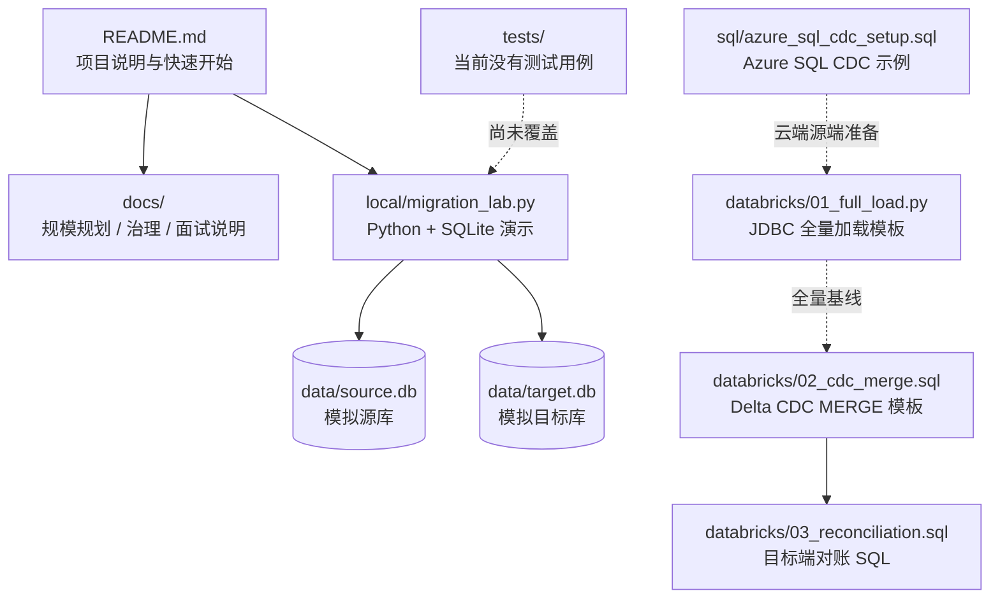
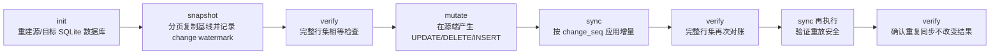

# 项目结构、运行与测试说明

## 项目定位

这是一个 Azure SQL 到 Databricks 的迁移学习实验项目，包含两部分：

- **可以本地运行的模拟器**：`local/migration_lab.py` 使用 Python 标准库和 SQLite，演示全量快照、模拟变更事件、增量同步、重放和逐行对账。
- **云端实现模板**：Azure SQL CDC SQL、Databricks JDBC 全量加载、Delta MERGE 和对账 SQL。它们需要真实云资源与配置；当前项目没有把它们连成可部署的云端 pipeline。

因此，本地成功只证明 SQLite 演示路径有效，不代表 Azure SQL CDC、Spark、Delta Lake 或生产切换已经验证。

## 目录结构

```text
.
├── README.md                         # 项目简介与快速开始
├── local/
│   └── migration_lab.py              # 本地 SQLite 迁移模拟器与 CLI
├── sql/
│   └── azure_sql_cdc_setup.sql       # Azure SQL CDC 启用示例（需 DBA 审核/权限）
├── databricks/
│   ├── 01_full_load.py               # JDBC 并行全量读取到 Delta 的模板
│   ├── 02_cdc_merge.sql              # CDC 落地后的 Delta MERGE 模板
│   └── 03_reconciliation.sql         # 目标端统计与唯一性检查 SQL
├── docs/
│   ├── project_overview.md           # 本文：结构、运行、测试与流程图
│   ├── scale_plan.md                 # 规模估算、迁移阶段与风险
│   ├── governance.md                 # 治理与元数据检查清单
│   └── interview.md                  # 项目说明素材
├── tests/                            # 当前为空，尚无自动化测试用例
└── .vscode/
    └── settings.json                 # VS Code agent skills 搜索路径配置
```

运行本地脚本后会在项目根目录创建 `data/source.db` 和 `data/target.db`。这两个 SQLite 文件是运行数据，不是源码或测试夹具。

## 结构与执行流程图





云端文件之间表达的是**目标迁移设计**，不由本地脚本自动调用。CDC 抽取器、LSN/offset 持久化、云端资源配置和完整 cutover 流程都需要后续工程实现。

## 如何运行本地演示

要求 Python 3；本地演示仅使用标准库，不需要安装第三方 Python 包。从项目根目录运行：

```powershell
python --version
python .\local\migration_lab.py demo --rows 10000
```

`demo` 会依次初始化数据、做全量快照、对账、生成 4 条示例变更（两次更新、一次删除、一次插入）、同步并重复执行同步验证。预期多次出现 `PASS: 100% exact row reconciliation (local test only)`。

也可以逐步运行，观察每个阶段：

```powershell
python .\local\migration_lab.py init --rows 10000
python .\local\migration_lab.py snapshot --chunk-size 2000
python .\local\migration_lab.py verify
python .\local\migration_lab.py mutate
python .\local\migration_lab.py sync
python .\local\migration_lab.py verify
python .\local\migration_lab.py sync
python .\local\migration_lab.py verify
```

命令说明：

| 命令 | 用途 |
|---|---|
| `init --rows N` | 创建合成支付数据并初始化源库、目标库 |
| `snapshot --chunk-size N` | 分页复制源表，并记录快照时的变更水位 |
| `mutate` | 在源库写入演示用 UPDATE、DELETE、INSERT 变更 |
| `sync` | 按变更序号将新事件应用到目标库；可重跑 |
| `verify` | 比较两端完整有序行集；不相等时以失败状态退出 |
| `demo --rows N` | 按固定顺序执行全流程，适合快速冒烟验证 |

**数据注意事项：** `init` 会删除并重建 `data/source.db` 和 `data/target.db`；`demo` 会调用 `init`，因此同样会清除这两个演示数据库。不要在其中保存需要保留的数据。

## 如何测试及测试边界

目前 `tests/` 目录为空，没有 pytest/unittest 测试用例，也没有项目级测试配置。现阶段可以把以下命令作为本地端到端冒烟/验收测试：

```powershell
python .\local\migration_lab.py demo --rows 10000
```

该流程实际检查初始化后的全量结果、变更同步后的结果，以及再次同步后的结果；`verify` 的判定依据是源/目标全部记录按主键排序后的行集完全相等，不只是行数和金额汇总。可用较小的 `--rows` 快速调试，再用更大数据量观察本机运行表现；这不是 1.2 TB 性能测试。

本地演示**不覆盖**：Azure SQL CDC 读取与 LSN 边界、并发写入期间的一致性、Databricks/Spark 执行、Delta 表写入、凭据/网络/权限、生产级 offset 提交或 21V 环境兼容性。

云端模板的验证需要在隔离的测试订阅/工作区中另行完成：

1. 由 DBA 审核并在测试 Azure SQL 环境配置 CDC、权限和保留期。
2. 在 Databricks 配置 JDBC 驱动、密钥管理、目标 catalog/schema/table，并验证 JDBC 全量读取。
3. 准备有序、去重且保留源序号的 CDC staging 数据后运行 MERGE，验证插入、更新、删除及迟到事件行为。
4. 在同一 CDC 水位比较源与目标的行数、主键唯一性、金额和抽样记录，并测试重放、断点恢复与回滚。

这些是后续云端验收步骤，不是当前仓库已有的自动化测试。
