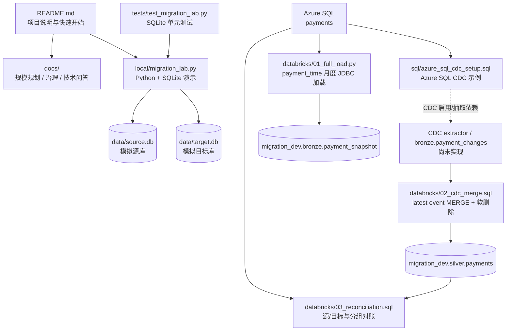
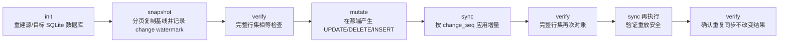

# 项目结构、运行与测试说明

## 项目定位

这是一个 Azure SQL 到 Databricks 的迁移学习实验项目，包含两部分：

- **可以本地运行的模拟器**：`local/migration_lab.py` 使用 Python 标准库和 SQLite，演示全量快照、模拟变更事件、增量同步、重放和逐行对账。
- **云端实现模板**：Azure SQL CDC SQL、Databricks 按月 JDBC 全量加载、基于最新 CDC 事件的 Delta MERGE（软删除）和源/目标对账 SQL。它们需要真实云资源与配置；当前项目没有把它们连成可部署的云端 pipeline。

因此，本地成功只证明 SQLite 演示路径有效，不代表 Azure SQL CDC、Spark、Delta Lake 或生产切换已经验证。

## 目录结构

```text
.
├── README.md                         # 项目简介与快速开始
├── README.zh-CN.md                   # 中文项目说明
├── local/
│   └── migration_lab.py              # 本地 SQLite 迁移模拟器与 CLI
├── sql/
│   └── azure_sql_cdc_setup.sql       # Azure SQL CDC 启用示例（需 DBA 审核/权限）
├── databricks/
│   ├── 01_full_load.py               # 按 payment_time 月度分批 JDBC 读取并替换 Delta 分区
│   ├── 02_cdc_merge.sql              # 最新 CDC 事件 Delta MERGE 与软删除标记模板
│   └── 03_reconciliation.sql         # Azure SQL 源端与 Databricks 目标端对账
├── docs/
│   ├── project_overview.md           # 本文：结构、运行、测试与流程图
│   ├── scale_plan.md                 # 规模估算、迁移阶段与风险
│   ├── governance.md                 # 治理与元数据检查清单
│   └── technical_qa.md               # 项目介绍与技术问答
├── tests/
│   └── test_migration_lab.py         # SQLite 模拟器单元测试
```

执行本地 `init` 或 `demo` 命令后，会在项目根目录创建 `data/source.db` 和 `data/target.db`。单元测试只使用临时目录，不会创建或覆盖这两个默认数据库。SQLite 文件是运行数据，不是源码或测试夹具。

## 结构与执行流程图





云端文件之间表达的是**目标迁移设计**，不由本地脚本自动调用。全量脚本按月覆盖 Bronze 快照分区；MERGE 从单独的 CDC landing 表选出每个 key 的最新事件并向 Silver 写入软删除标记。这两个模板目前没有实现从全量 Bronze 快照初始化 Silver 表的连接步骤。CDC 抽取器、LSN/offset 持久化、Bronze/Silver 表、云端资源配置和完整 cutover 流程都需要后续工程实现。

## 如何运行本地演示

要求 Python 3；本地演示仅使用标准库，不需要安装第三方 Python 包。从项目根目录运行：

```powershell
python --version
python .\local\migration_lab.py demo --rows 10000
```

`demo` 会依次初始化数据、做全量快照、对账、生成 4 条示例变更（两次更新、一次删除、一次插入）、同步并重复执行同步验证。预期多次出现 `PASS: 100% exact row reconciliation (local test only)`。

也可以逐步运行，观察每个阶段：

```powershell
python .\local\migration_lab.py init --rows 10000
python .\local\migration_lab.py snapshot --chunk-size 2000
python .\local\migration_lab.py verify
python .\local\migration_lab.py mutate
python .\local\migration_lab.py sync
python .\local\migration_lab.py verify
python .\local\migration_lab.py sync
python .\local\migration_lab.py verify
```

命令说明：

| 命令 | 用途 |
|---|---|
| `init --rows N` | 创建合成支付数据并初始化源库、目标库 |
| `snapshot --chunk-size N` | 分页复制源表，并记录快照时的变更水位 |
| `mutate` | 在源库写入演示用 UPDATE、DELETE、INSERT 变更 |
| `sync` | 按变更序号将新事件应用到目标库；可重跑 |
| `verify` | 对两端全部列执行双向差集比较；不相等时以失败状态退出 |
| `demo --rows N` | 按固定顺序执行全流程，适合快速冒烟验证 |

**数据注意事项：** `init` 会删除并重建 `data/source.db` 和 `data/target.db`；`demo` 会调用 `init`，因此同样会清除这两个演示数据库。不要在其中保存需要保留的数据。

## 如何测试及测试边界

项目使用 Python 标准库 `unittest`，不需要安装第三方测试依赖。运行单元测试和本地端到端冒烟测试：

```powershell
python -m unittest discover -s tests -v
python .\local\migration_lab.py demo --rows 10000
```

单元测试使用临时数据库，覆盖初始化参数保护、分批快照、变更同步/重放、对账差异识别和路径检查。端到端流程检查初始化、增量同步和重复同步后的结果；`verify` 通过 SQLite 双向 `EXCEPT` 比较两端全部列，不把全部记录加载进 Python 内存。可用较小的 `--rows` 快速调试，再用更大数据量观察本机运行表现；这不是 1.2 TB 性能测试。

本地演示**不覆盖**：Azure SQL CDC 读取与 LSN 边界、并发写入期间的一致性、Databricks/Spark 执行、Delta 表写入、凭据/网络/权限、生产级 offset 提交或 21V 环境兼容性。

云端模板的验证需要在隔离的测试订阅/工作区中另行完成：

1. 由 DBA 审核并在测试 Azure SQL 环境配置 CDC、权限和保留期。
2. 在 Databricks 配置 JDBC 驱动、密钥管理、目标 catalog/schema/table，并验证按 `payment_time` 月度读取和 `replaceWhere` 分区替换。
3. 实现 CDC 抽取并将事件写入 `bronze.payment_changes`；验证序号唯一性、每个 key 最新事件选择、软删除，以及迟到/乱序事件策略。
4. 分别在 Azure SQL 和 Databricks 执行对账查询，在同一 CDC 水位比较 Silver 表的总体、月度、商户金额/行数和主键唯一性，并测试重放、断点恢复与回滚。

源端和目标端查询使用不同 SQL 方言，需分别在各自引擎执行并比较结果。这些是后续云端验收步骤，不是当前仓库已有的自动化测试。
